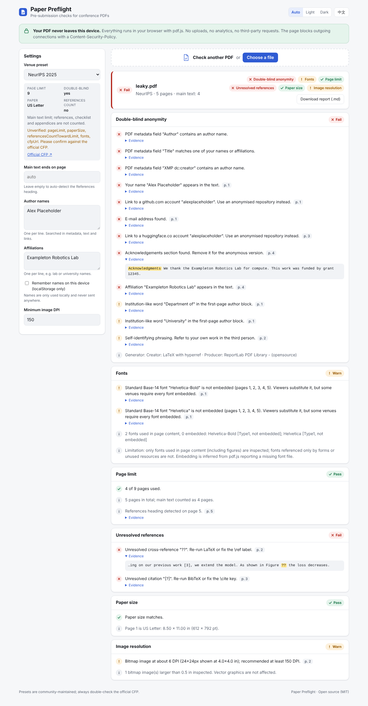
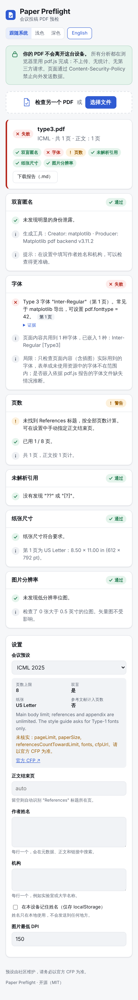
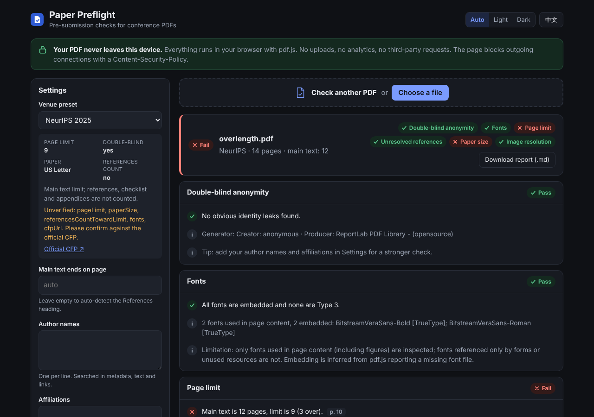

# Paper Preflight

**Check your conference submission PDF before you hit "submit" — entirely in your browser.**

Drop a PDF on the page and get a report on the things that get papers desk-rejected or embarrass authors:
identity leaks in a double-blind submission, Type 3 or non-embedded fonts, page-limit overruns and
leftover `??` / `[?]` from LaTeX. Every finding comes with a severity (pass / warn / fail), the page
number and an expandable evidence snippet.

[中文说明见下方](#中文说明)



| Mobile, Chinese UI | Dark theme |
| --- | --- |
|  |  |

## Privacy promise

- **Your PDF never leaves your device.** Parsing is done by [pdf.js](https://github.com/mozilla/pdf.js),
  bundled into the site. There is no server component, no upload, no analytics, no fonts or scripts from a CDN.
- The production build sets a `Content-Security-Policy` with `connect-src 'self'`, so the browser itself
  refuses to send data to any other host. An end-to-end test asserts that analysing a PDF makes no
  external request.
- Author names and affiliations you type are used only in memory. They are written to `localStorage`
  only if you tick "Remember names on this device", and removed when you untick it.
- You can also run it fully offline: `npm run build` and open `dist/` with any static file server.

## What it checks

| Check | What is detected | Severity |
| --- | --- | --- |
| **Double-blind anonymity** | `Author` (and other) PDF metadata fields, XMP `dc:creator`; an *Acknowledg(e)ments* heading; github.com / gitlab.com / huggingface.co / bitbucket.org / codeberg.org account links (text and link annotations); personal homepages (`*.github.io`, `~user`, Google Sites, Scholar, ORCID); e-mail addresses; institution words in the first-page author block; self-citation phrasing ("our previous work", "we previously", "in our prior paper", ...); **your own list of names and affiliations** (accent- and case-insensitive). | fail / warn |
| **Fonts** | Type 3 fonts; fonts that are not embedded, with Base-14 fonts reported separately. | fail / warn per venue |
| **Page limit** | Main-text pages vs. the venue limit. The end of the main text is the page with the *References* / *Bibliography* heading (auto-detected), or a page you enter. | fail |
| **Unresolved references** | `??` (unresolved `\ref`) and `[?]`, `[?, ?]` (unresolved `\cite`). | fail |
| **Paper size** | US Letter vs. A4 against the venue preset; mixed page sizes. | fail / warn |
| **Image resolution** | Bitmaps rendered below a DPI threshold (default 150), computed from pixel size and placed size. | warn |

Anonymity findings are downgraded to *info* for venues that are not double-blind. The report can be
downloaded as Markdown.

## Venue presets

Presets live in [`presets/*.json`](presets/) and are picked up automatically at build time.
Currently included: NeurIPS, ICLR, ICML, CVPR, ACL/ARR long, ACL/ARR short, AAAI, and a generic
double-blind preset.

> **Please verify.** The venue presets were checked against the official CFP / author guidelines of the
> latest published edition on 2026-10-21 (`lastChecked`), with the pages used listed in `sources`. Fields
> that could not be confirmed from an official page (mostly `fonts`, and `paperSize` for some venues) are
> still listed in the preset's `unverified` array and shown in the UI. Limits change from year to year —
> always read the official CFP. Pull requests that verify the remaining fields are very welcome.

Example:

```json
{
  "$schema": "./schema.json",
  "id": "neurips",
  "name": "NeurIPS",
  "edition": "2026",
  "pageLimit": 9,
  "doubleBlind": true,
  "paperSize": "letter",
  "referencesCountTowardLimit": false,
  "fonts": { "allowType3": true, "requireAllEmbedded": false },
  "cfpUrl": "https://neurips.cc/Conferences/2026/CallForPapers",
  "notes": "Main track: nine content pages including figures and tables; references, optional technical appendices and the mandatory checklist do not count. Accepted papers get one extra page.",
  "sources": [
    "https://neurips.cc/Conferences/2026/CallForPapers",
    "https://neurips.cc/Conferences/2026/MainTrackHandbook"
  ],
  "unverified": ["paperSize", "fonts"],
  "lastChecked": "2026-10-21"
}
```

| Field | Meaning |
| --- | --- |
| `id` | kebab-case, must equal the file name |
| `pageLimit` | main-text page limit, or `null` |
| `doubleBlind` | enables anonymity failures |
| `paperSize` | `"letter"`, `"a4"` or `null` |
| `referencesCountTowardLimit` | `true` if the limit includes references (then all pages are counted) |
| `referencesPageLimit` | optional extra pages allowed for references only |
| `fonts.allowType3` | `false` turns Type 3 warnings into failures |
| `fonts.requireAllEmbedded` | `true` turns non-embedded Base-14 warnings into failures |
| `cfpUrl` | official CFP / author guidelines (https) |
| `sources` | optional list of official pages (https) the values were checked against |
| `unverified` | names of fields not yet checked against the official source |
| `lastChecked` | `YYYY-MM-DD` when someone verified the values |

### Adding a venue

1. Copy an existing file to `presets/<venue>.json` and edit it. The JSON schema is in
   [`presets/schema.json`](presets/schema.json); editors such as VS Code validate it automatically.
2. Fill `cfpUrl` with the official page, list the pages you checked in `sources`, and list any field you
   could not confirm in `unverified`.
3. Run `npm test` — `tests/unit/presets.test.ts` validates every preset.
4. Open a pull request. See [CONTRIBUTING.md](CONTRIBUTING.md).

## Local development

Requirements: Node.js 20+ (22 recommended). Python 3 with `reportlab`, `pypdf` and `matplotlib` is only
needed to regenerate the test fixtures.

```bash
npm install
npm run dev          # http://localhost:5173
npm test             # unit tests (vitest), including pdf.js on the fixtures
npm run build        # type-check + static build into dist/
npm run test:e2e     # Playwright against the built site (needs a Chromium: npx playwright install chromium)
npm run fixtures     # regenerate tests/fixtures/*.pdf
```

Project layout:

```
src/core/          analysis core, no DOM: extract.ts (pdf.js -> DocModel), checks/*, run.ts
src/main.ts        UI (vanilla TypeScript), src/i18n.ts (English / Chinese strings)
presets/           venue presets + JSON schema
tests/unit/        vitest; tests/e2e/ Playwright; tests/fixtures/ generated PDFs
scripts/           fixture generator
```

Deployment: see [DEPLOY.md](DEPLOY.md) (GitHub Pages via Actions, or Cloudflare Pages).

## Limitations

- **Heuristics, not a guarantee.** A clean report does not mean the paper is anonymous or compliant;
  it means none of the patterns above were found. Read the venue's instructions.
- **Text extraction.** Text comes from pdf.js. Two-column pages are merged line by line, hyphenated
  words are not rejoined, and text inside figures is only seen if it is real text (not outlines or
  bitmaps). Scanned PDFs without a text layer cannot be checked for text issues.
- **Fonts.** Only fonts actually used to draw text in page content (including embedded figures) are
  inspected; fonts referenced only by annotations, form fields or unused resources are not. "Not
  embedded" is inferred from pdf.js reporting a missing font file. Base-14 fonts are listed separately
  because viewers substitute them, but some venues still require them to be embedded.
- **Page counting** relies on a *References* / *Bibliography* heading. If it is missing, renamed or
  the venue counts differently (e.g. limitations sections), set the last main-text page manually.
- **Institution detection** without your own list only looks at the first-page author block, to avoid
  flagging citations and dataset names.
- **Image resolution** covers image XObjects and inline images; images inside patterns or shadings are
  not measured.
- **Presets** are only partly verified; remaining fields are listed in `unverified` (see above).

## License

[MIT](LICENSE) © Paper Preflight contributors

---

## 中文说明

**Paper Preflight** 是一个给投学术会议的研究者用的 PDF 投稿预检网页：把 PDF 拖进页面，就能得到一份检查报告，每条结果都有 通过 / 警告 / 失败、所在页码和可展开的证据片段。

**隐私承诺**：所有分析都在你的浏览器里用打包进来的 pdf.js 完成，没有服务器、不上传、无统计、不从 CDN 加载任何资源。生产构建带有 `connect-src 'self'` 的 Content-Security-Policy，浏览器会直接拦截向其他域名发送数据。你填写的作者姓名和机构只在内存中使用，只有勾选"在本设备记住姓名"时才会写入 localStorage。

**检查项**：

1. **双盲匿名**：PDF 元数据（Author/Title/XMP 等）、致谢段落、GitHub/GitLab/Hugging Face 等账号链接、个人主页、邮箱、首页作者区的机构名、"our previous work / we previously" 一类自引措辞，以及你自己填写的姓名和机构列表（忽略大小写和重音符号）。
2. **字体**：Type 3 字体、未嵌入字体（Base-14 标准字体单独说明）。
3. **页数**：按会议预设检查正文页数，正文结束页可自动识别 "References" 标题，也可手动指定。
4. **未解析引用**：正文中的 `??` 和 `[?]`。
5. **纸张尺寸**（Letter / A4）和**低分辨率位图**。

**会议预设**放在 `presets/*.json`，新增一个会议只需要加一个 JSON 文件并提 PR。**注意：现有预设已于 2026-10-21 对照各会议最新一届的官方 CFP / 作者指南核对（`lastChecked`），所依据的页面列在 `sources` 中；无法从官方页面确认的字段（主要是 `fonts`，部分会议的 `paperSize`）仍列在 `unverified` 中并在界面上提示，欢迎社区核对后提交 PR。**

**本地开发**：`npm install`，`npm run dev`；测试 `npm test`；构建 `npm run build`；端到端测试 `npm run test:e2e`。

**局限**：所有检查都是启发式的，报告"通过"不代表一定合规；双栏排版按行合并文本；字体检查只覆盖页面内容实际使用的字体；页数统计依赖 References 标题；预设中仍有部分字段未经核实。投稿前请务必阅读会议官方要求。
